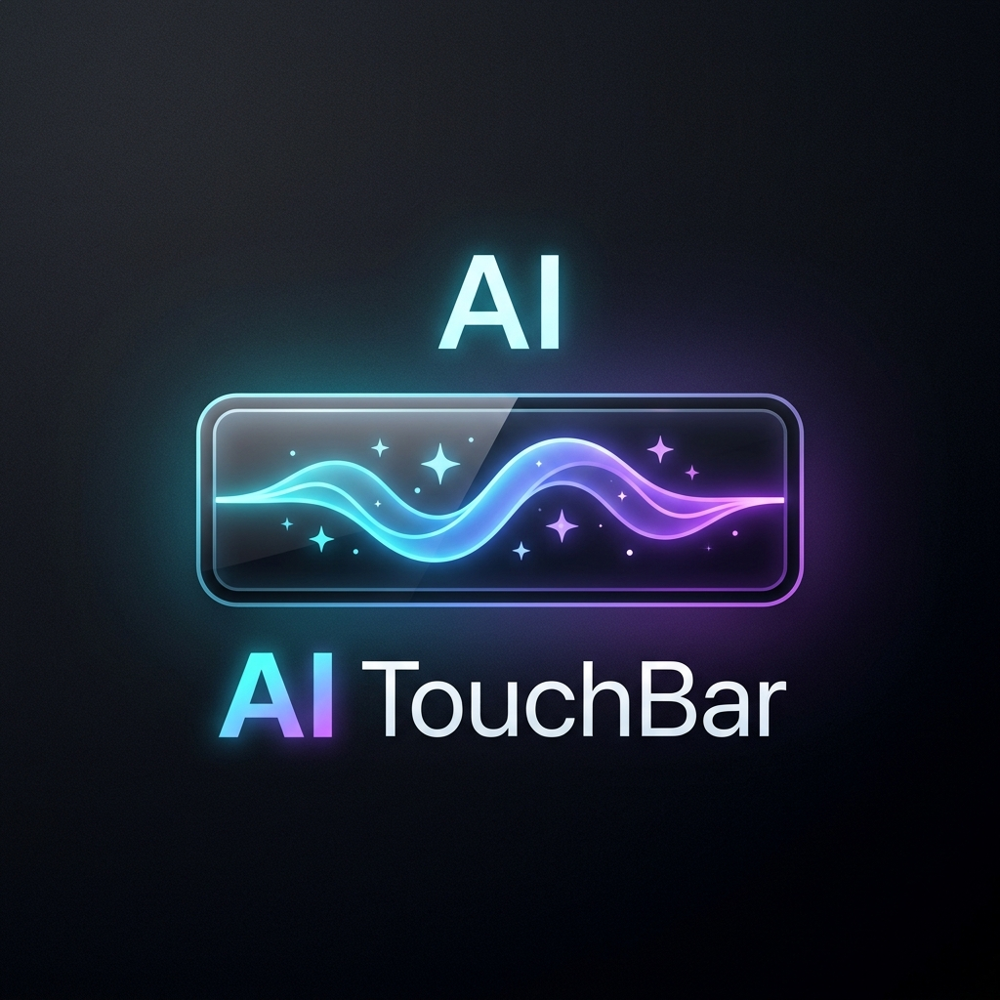

<p align="center">
  
</p>

<h1 align="center">AI TouchBar</h1>

<p align="center">
  <strong>Monitor de cotas e uso de IA em tempo real diretamente na Touch Bar física do MacBook.</strong>
</p>

<p align="center">
  
  
  
  
</p>

---

## 🚧 Status do Projeto (Em Desenvolvimento)

> **Nota:** Este projeto está em **desenvolvimento ativo**!  
> A versão atual integra o monitoramento em tempo real do **Antigravity IDE / Gemini** via engenharia reversa no barramento local.

### 🗺️ Roadmap de Integrações Futuras:
- [x] **Antigravity IDE / Google Gemini**: Suporte completo a cota de 5 horas e limite semanal em tempo real.
- [ ] **OpenAI Codex & ChatGPT API**: Monitoramento de tokens e saldo restante da API.
- [ ] **Anthropic Claude**: Rastreamento de cotas de uso do Claude 3.5 Sonnet / Opus.
- [ ] **Ollama / Modelos Locais**: Exibição de uso de VRAM, RAM e tamanho de contexto na Touch Bar.
- [ ] **Início com o Sistema**: Opção para adicionar aos itens de inicialização do macOS com 1 clique.
- [ ] **Feedback Tátil**: Resposta haptic na Touch Bar ao interagir com os botões.

---

## ✨ Recursos Atuais

- 🟢 **Slot Físico no Control Strip**: Um display compacto de 68pt (`✨ 85%`) posicionado diretamente ao lado dos controles do sistema (brilho e volume), visível em qualquer aplicativo aberto.
- 📊 **Mini Barra de Gradiente Dinâmica**:
  - **Verde/Ciano**: Cota segura (> 50%).
  - **Âmbar**: Cota moderada (20% a 50%).
  - **Vermelho**: Cota baixa (< 20%).
- 📱 **Painel Expandido Interativo (Modal Touch Bar)**: Ao tocar no botão na Touch Bar, expande um dashboard interativo por toda a largura do teclado:
  - `[ 🤖 Gemini 3.8 Flash ]`: Modelo atualmente ativo no editor.
  - `[ ⏱️ 5h: 85% ]`: Cota do limite de 5 horas (curto prazo).
  - `[ 📅 Semanal: 96% ]`: Cota geral semanal.
  - `[ 💎 Claude/GPT: 100% ]`: Status de cotas de terceiros.
  - `[ ⭐️ Google AI Pro ]`: Nível do plano ativo.
  - `[ 🔄 Atualizar ]`: Força nova leitura imediata.
  - `[ ✕ Fechar ]`: Recolhe a Touch Bar ao estado anterior.
- 🍏 **Ícone na Barra de Menus (Menu Bar)**:
  - Exibe a porcentagem no canto superior da tela com detalhes dos tempos exatos para a próxima renovação.

---

## 🔍 Engenharia Reversa (Como Funciona)

1. **Injeção no Control Strip (`DFRFoundation` & `TouchBarServer`)**:
   - A Touch Bar no macOS é orquestrada pelo daemon `/usr/libexec/TouchBarServer`.
   - Utilizando as chamadas do framework privado `/System/Library/PrivateFrameworks/DFRFoundation.framework`, o app registra um item persistente no Control Strip (`DFRElementSetControlStripPresenceForIdentifier` e `[NSTouchBarItem addSystemTrayItem:]`).
   - Ao toque, ativa a modalidade completa via `[NSTouchBar presentSystemModalTouchBar:systemTrayItemIdentifier:]`.

2. **Leitura da Cota em Tempo Real (ConnectRPC)**:
   - O aplicativo se comunica diretamente com o **Language Server interno** (`language_server_macos_x64`) via HTTPS local / ConnectRPC no endpoint:
     `/exa.language_server_pb.LanguageServerService/RetrieveUserQuotaSummary`
   - O token de autorização `x-codeium-csrf-token` é descoberto dinamicamente em tempo de execução, garantindo dados idênticos aos da tela de configurações do editor.

---

## 🛠️ Como Compilar e Executar

### Pré-requisitos:
- macOS com Touch Bar física (ou simulador de Touch Bar) rodando macOS 10.14+.
- Xcode Command Line Tools (`xcode-select --install`).
- Python 3 (já embutido no macOS).

### Instalação:

1. Clone o repositório:
```bash
git clone https://github.com/D3ymon4ke/ai-touchbar.git
cd ai-touchbar
```

2. Compile e inicie o aplicativo:
```bash
make run
```

3. Para encerrar o aplicativo:
```bash
make stop
```

---

## 📄 Licença

Distribuído sob a licença MIT. Veja `LICENSE` para mais detalhes.
